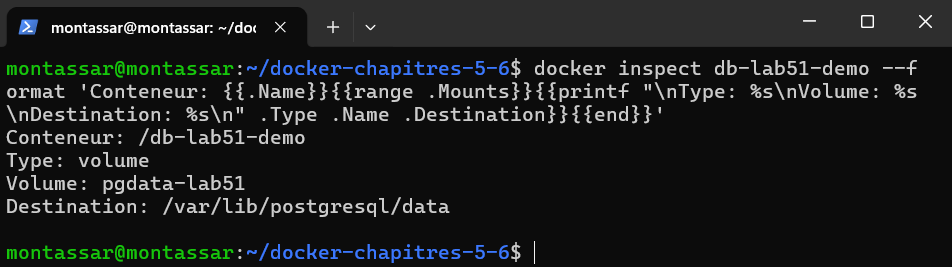
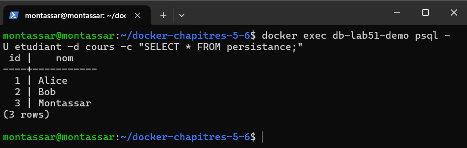
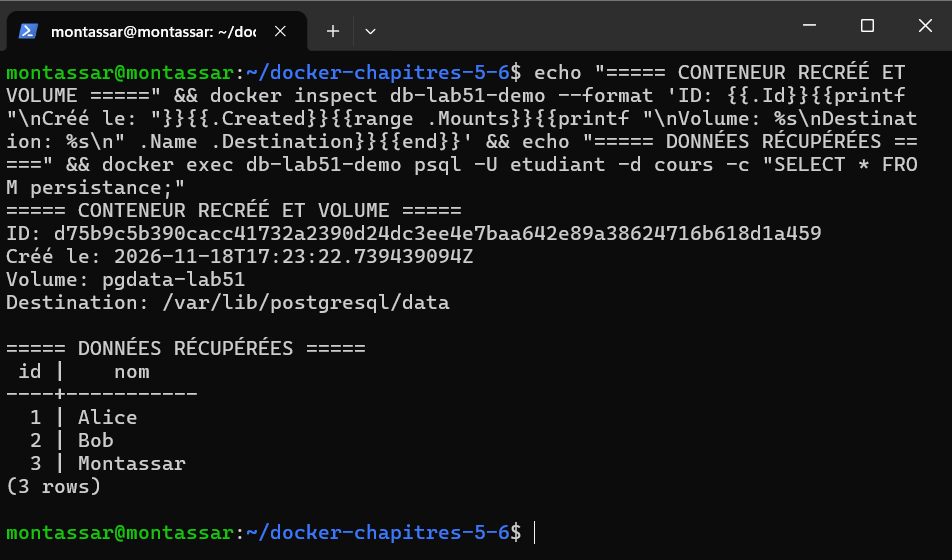

# Lab 5.1 — Persister des données avec Docker

## 1. Objectifs

Ce laboratoire permet de comprendre la persistance des données avec Docker et le fonctionnement des volumes nommés.

- Comprendre la différence entre le cycle de vie d'un conteneur et celui d'un volume.
- Créer et utiliser un volume Docker nommé.
- Vérifier la conservation des données après suppression et recréation d'un conteneur.

## 2. Environnement technique

- Système : Ubuntu
- Moteur : Docker
- Image : `postgres:16-alpine`
- SGBD : PostgreSQL 16.15
- Utilisateur : `etudiant`
- Base de données : `cours`
- Conteneur de démonstration : `db-lab51-demo`
- Volume nommé : `pgdata-lab51`

## 3. Création du conteneur avec un volume nommé

Le conteneur PostgreSQL est créé en associant le volume `pgdata-lab51` au répertoire de données PostgreSQL.

```bash
docker run -d \
  --name db-lab51-demo \
  -e POSTGRES_USER=etudiant \
  -e POSTGRES_PASSWORD='********' \
  -e POSTGRES_DB=cours \
  -v pgdata-lab51:/var/lib/postgresql/data \
  postgres:16-alpine
```

Vérification du montage :

```bash
docker inspect db-lab51-demo --format \
'{{range .Mounts}}{{printf "Type: %s\nVolume: %s\nDestination: %s\n" .Type .Name .Destination}}{{end}}'
```

Résultat :

```text
Type: volume
Volume: pgdata-lab51
Destination: /var/lib/postgresql/data
```



## 4. Création et insertion des données

Une table `persistance` est créée dans la base `cours`, puis trois enregistrements sont insérés.

```sql
CREATE TABLE persistance (
    id SERIAL PRIMARY KEY,
    nom VARCHAR(50)
);

INSERT INTO persistance (nom)
VALUES ('Alice'), ('Bob'), ('Montassar');

SELECT * FROM persistance;
```

Résultat obtenu :

| id | nom |
|---:|---|
| 1 | Alice |
| 2 | Bob |
| 3 | Montassar |

## 5. Suppression et recréation du conteneur

Le conteneur initial est supprimé sans supprimer le volume :

```bash
docker rm -f db-lab51-demo
```

Le conteneur est ensuite recréé en utilisant le même volume :

```bash
docker run -d \
  --name db-lab51-demo \
  -e POSTGRES_USER=etudiant \
  -e POSTGRES_PASSWORD='********' \
  -e POSTGRES_DB=cours \
  -v pgdata-lab51:/var/lib/postgresql/data \
  postgres:16-alpine
```

Le volume conserve les données même après la suppression du conteneur.

## 6. Vérification de la persistance

Après recréation du conteneur, la requête suivante est exécutée :

```bash
docker exec db-lab51-demo \
  psql -U etudiant -d cours -c "SELECT * FROM persistance;"
```

Résultat obtenu :

```text
 id |    nom
----+-----------
  1 | Alice
  2 | Bob
  3 | Montassar
(3 rows)
```



La vérification du conteneur et du volume confirme également que le volume `pgdata-lab51` est toujours monté.



## 7. Comparaison

| Sans volume nommé | Avec volume nommé |
|---|---|
| Les données sont stockées dans la couche inscriptible du conteneur. | Les données sont stockées dans un volume indépendant. |
| La suppression du conteneur entraîne la perte de ses données locales. | Les données restent disponibles après suppression du conteneur, tant que le volume est conservé. |
| Persistance non assurée lors de la recréation. | Persistance assurée grâce à la réutilisation du volume. |

## 8. Conclusion

Ce laboratoire démontre l'intérêt des volumes Docker pour les applications qui nécessitent une conservation durable des données, notamment les bases de données.

La suppression du conteneur `db-lab51-demo`, suivie de sa recréation avec le même volume `pgdata-lab51`, n'a pas entraîné la perte des trois enregistrements PostgreSQL.

Le test confirme donc l'indépendance entre le cycle de vie du conteneur et celui du volume nommé.

## 9. Questions de réflexion

### 1. Pourquoi `docker volume ls` montre-t-il un volume anonyme par conteneur créé à l'étape 1 ?

L'image officielle PostgreSQL déclare un volume sur le chemin `/var/lib/postgresql/data`. Même sans spécifier de volume nommé, Docker crée automatiquement un volume anonyme pour stocker les données de PostgreSQL. Chaque nouveau conteneur peut donc recevoir un nouveau volume anonyme.

### 2. Pourquoi les variables d'environnement `POSTGRES_*` sont-elles ignorées au second démarrage ?

Les variables `POSTGRES_USER`, `POSTGRES_PASSWORD` et `POSTGRES_DB` sont utilisées uniquement lors de l'initialisation d'un répertoire de données PostgreSQL vide. Lorsque le volume contient déjà une base initialisée, PostgreSQL conserve sa configuration existante. Modifier ces variables ne change donc pas automatiquement les identifiants ou la base existante.

### 3. Dans quel cas utiliseriez-vous un bind mount plutôt qu'un volume nommé ?

J'utiliserais un bind mount lorsque je souhaite partager directement un dossier ou un fichier de l'hôte avec un conteneur, par exemple pour développer un site web avec Nginx et modifier les fichiers sans reconstruire ni redémarrer le conteneur. Un volume nommé est préférable pour conserver les données persistantes gérées par Docker, comme celles d'une base PostgreSQL.
