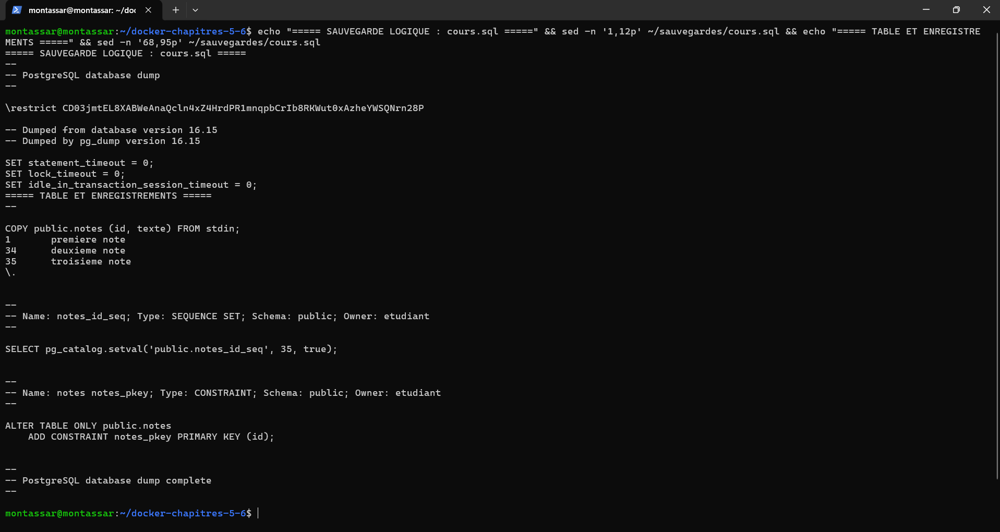
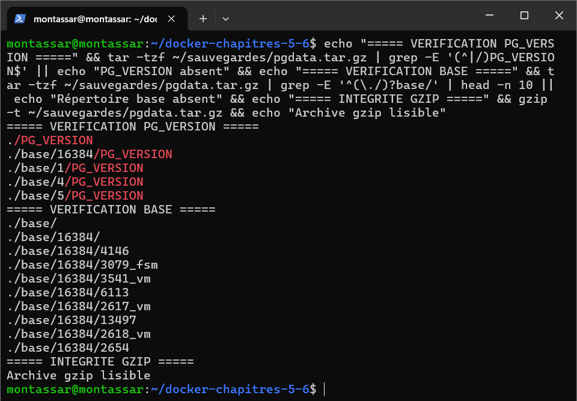
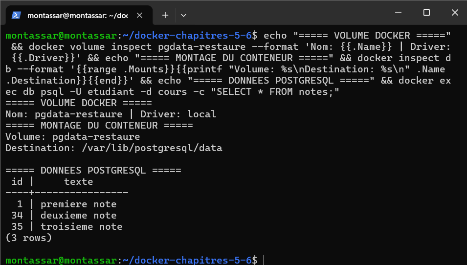

# Lab 5.2 — Sauvegarder et restaurer un volume Docker

## 1. Objectifs

- Comprendre les mécanismes de sauvegarde des données PostgreSQL.
- Distinguer une sauvegarde logique d'une sauvegarde physique.
- Vérifier les données présentes dans un volume Docker utilisé par un conteneur.

## 2. Environnement

- Système : Ubuntu
- Conteneurisation : Docker
- Image PostgreSQL : `postgres:16-alpine`
- Base de données : `cours`
- Utilisateur : `etudiant`

## 3. Sauvegarde logique

Le fichier `~/sauvegardes/cours.sql` a été identifié comme un export PostgreSQL produit avec `pg_dump` version 16.15.

Son inspection a confirmé la présence de la table `notes` et des enregistrements suivants :

| id | texte |
|---:|---|
| 1 | premiere note |
| 34 | deuxieme note |
| 35 | troisieme note |

Le fichier se termine par la mention `PostgreSQL database dump complete`.



## 4. Sauvegarde physique

L’archive `~/sauvegardes/pgdata.tar.gz` a été retrouvée. Sa taille vérifiée est de 6 666 209 octets.

Son contenu a été inspecté avec `tar -tzf`. Il comprend notamment les répertoires `pg_wal`, `global` et `pg_logical`, ainsi que le fichier `pg_hba.conf`.

Cette inspection confirme la présence de fichiers de données PostgreSQL dans l’archive.



## 5. Vérification du volume

Le conteneur `db` utilise le volume Docker `pgdata-restaure`, monté dans `/var/lib/postgresql/data`.

La commande suivante a permis de vérifier les données présentes dans la base :

```bash
docker exec db psql -U etudiant -d cours -c "SELECT * FROM notes;"
```

Les trois enregistrements observés sont identiques à ceux présents dans le fichier SQL.



## 6. Limites de vérification

Les vérifications confirment l’existence du dump SQL, de l’archive physique et des données dans le volume actuellement utilisé.

Elles ne permettent toutefois pas de déterminer si le volume `pgdata-restaure` provient de l’archive physique ou du fichier SQL. La méthode exacte de restauration ne peut donc pas être affirmée.

## 7. Conclusion

Ce laboratoire présente deux approches de sauvegarde PostgreSQL : l’export logique avec `pg_dump` et l’archivage physique des fichiers de données.

Il montre également l’importance de vérifier le contenu des sauvegardes et les données disponibles après une restauration.
