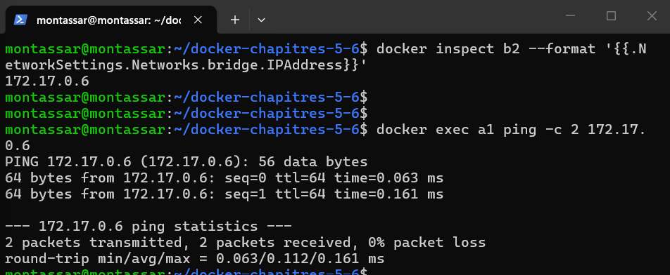
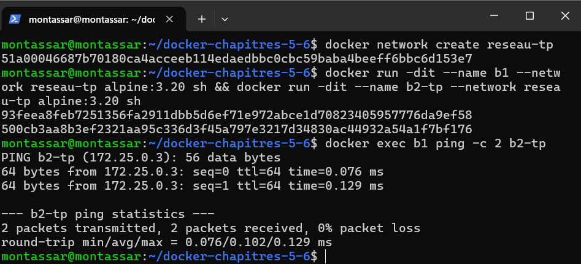
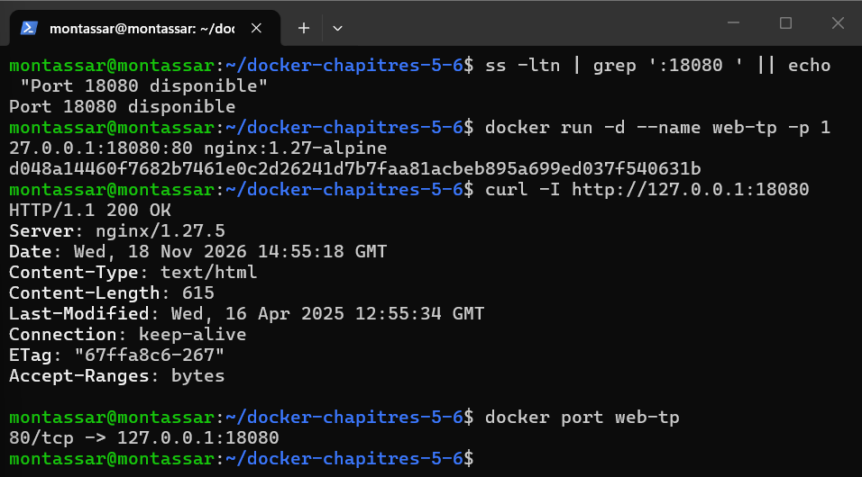
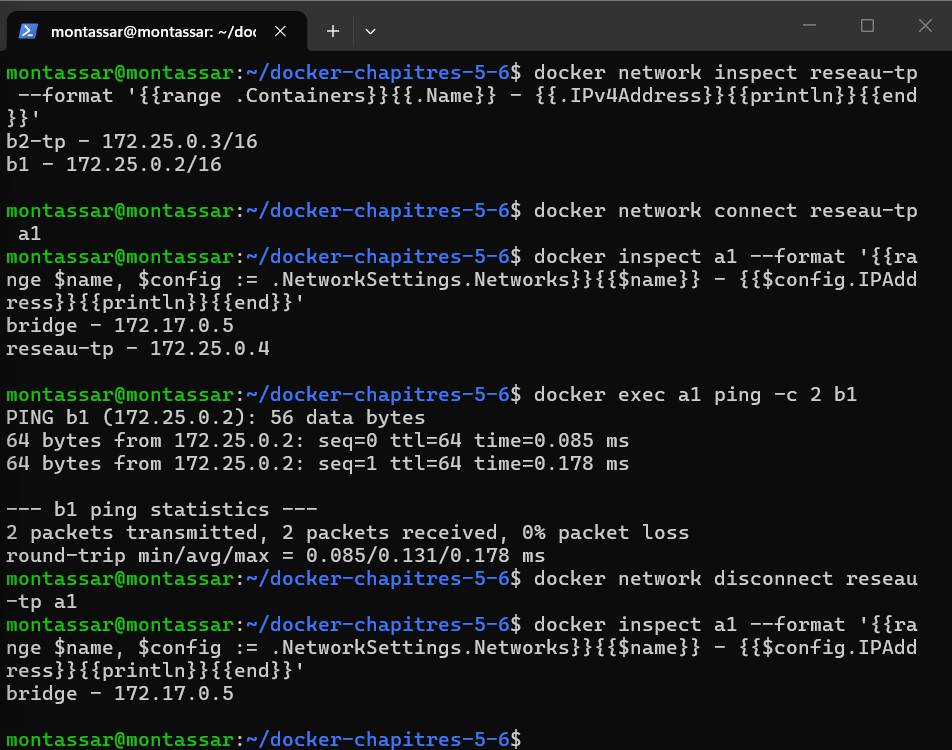
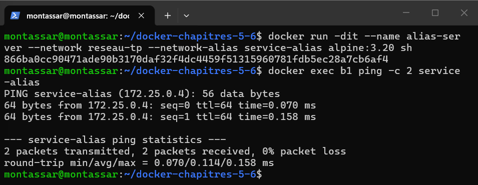
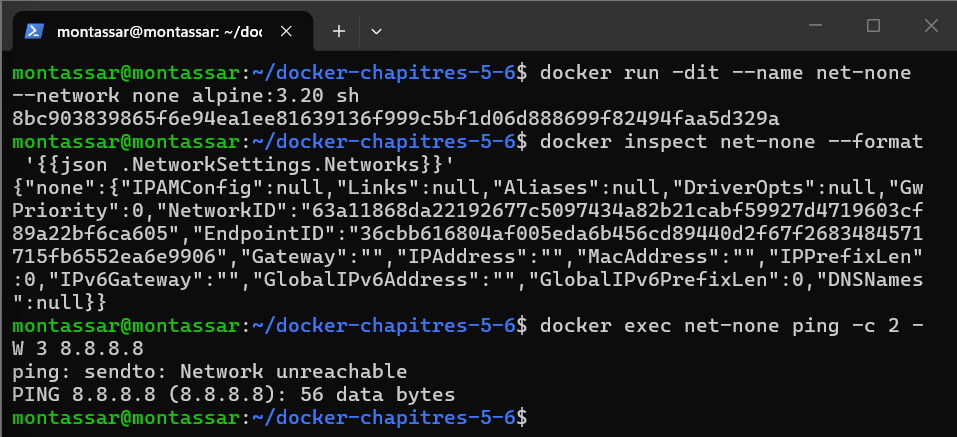
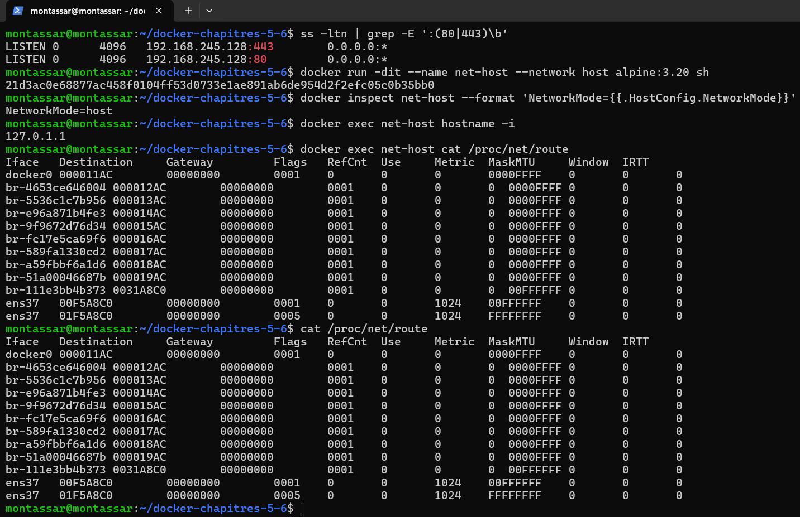

# Lab 6.1 — Réseaux Docker

## 1. Objectifs

Ce laboratoire a pour objectif de comprendre le fonctionnement des réseaux Docker et de maîtriser les différents modes de communication entre conteneurs.

Les compétences travaillées sont :

- Comprendre le réseau bridge par défaut.
- Créer et utiliser un réseau bridge personnalisé.
- Tester la résolution DNS entre conteneurs.
- Publier des ports pour rendre un service accessible depuis l'hôte.
- Connecter et déconnecter des conteneurs à un réseau.
- Utiliser les alias DNS.
- Comprendre les modes `none` et `host`.

## 2. Environnement de travail

| Élément | Configuration |
|---|---|
| Système | Ubuntu |
| Outil | Docker Engine |
| Image de test | `alpine:3.20` |
| Image Web | `nginx:1.27-alpine` |
| Réseau personnalisé | `reseau-tp` |
| Conteneurs de test | `a1`, `b2`, `b1`, `b2-tp`, `web-tp`, `alias-server`, `net-none`, `net-host` |

## 3. Étude du réseau bridge par défaut

Deux conteneurs, `a1` et `b2`, ont été lancés sur le réseau `bridge` par défaut.

### 3.1. Test de résolution DNS

La commande suivante a été exécutée :

```bash
docker exec a1 ping -c 2 b2
```

Résultat :

```text
ping: bad address 'b2'
```

La résolution automatique du nom `b2` n'a donc pas fonctionné sur le bridge par défaut.

### 3.2. Test de communication par adresse IP

L'adresse IP de `b2` était `172.17.0.6`.

```bash
docker exec a1 ping -c 2 172.17.0.6
```

Résultat :

```text
2 packets transmitted, 2 packets received, 0% packet loss
```

La communication par adresse IP a fonctionné malgré l'absence de résolution DNS automatique par nom.



## 4. Création d'un réseau bridge personnalisé

Un réseau bridge personnalisé nommé `reseau-tp` a été utilisé.

Les conteneurs `b1` et `b2-tp` ont été connectés à ce réseau.

### Test de communication et résolution DNS

```bash
docker exec b1 ping -c 2 b2-tp
```

Résultat :

```text
PING b2-tp (172.25.0.3)
2 packets transmitted, 2 packets received, 0% packet loss
```

Le nom `b2-tp` a été automatiquement résolu vers l'adresse IP `172.25.0.3`.



## 5. Publication des ports

La publication des ports permet de rendre un service exécuté dans un conteneur accessible depuis l'hôte.

Un conteneur Nginx nommé `web-tp` a été utilisé avec la configuration suivante :

```bash
-p 127.0.0.1:18080:80
```

Cette configuration redirige le port `18080` de l'hôte vers le port `80` du conteneur. L'écoute est limitée à l'interface locale `127.0.0.1`.

### Vérification

```bash
curl -I http://127.0.0.1:18080
```

Résultat :

```text
HTTP/1.1 200 OK
Server: nginx/1.27.5
```

Vérification du port publié :

```bash
docker port web-tp
```

Résultat :

```text
80/tcp -> 127.0.0.1:18080
```



## 6. Connexion et déconnexion des réseaux

Docker permet de connecter un conteneur à un réseau existant et de le déconnecter sans devoir le recréer.

Commandes utilisées :

```bash
docker network connect reseau-tp a1
docker inspect a1
docker exec a1 ping -c 2 b1
docker network disconnect reseau-tp a1
```

Après connexion, le conteneur `a1` possédait deux interfaces réseau :

| Réseau | Adresse IP |
|---|---|
| bridge | `172.17.0.5` |
| reseau-tp | `172.25.0.5` |

Le test de communication avec `b1` a réussi avec `0% packet loss`.

Après déconnexion, `a1` était de nouveau uniquement connecté au réseau `bridge`.



## 7. Utilisation des alias DNS

Un conteneur nommé `alias-server` a été connecté au réseau `reseau-tp` avec l'alias DNS `service-alias`.

Commande de création :

```bash
docker run -dit \
  --name alias-server \
  --network reseau-tp \
  --network-alias service-alias \
  alpine:3.20 sh
```

Test :

```bash
docker exec b1 ping -c 2 service-alias
```

Résultat :

```text
PING service-alias (172.25.0.4)
2 packets transmitted, 2 packets received, 0% packet loss
```

L'alias `service-alias` a correctement été résolu vers l'adresse IP `172.25.0.4`.



## 8. Modes réseau none et host

### 8.1. Mode none

Un conteneur `net-none` a été lancé avec le mode réseau `none`.

```bash
docker inspect net-none --format '{{json .NetworkSettings.Networks}}'
```

Le conteneur était connecté uniquement au réseau `none`, sans adresse IP ni passerelle configurée.

Test de connectivité :

```bash
docker exec net-none ping -c 2 -W 3 8.8.8.8
```

Résultat :

```text
ping: sendto: Network unreachable
```

Ce résultat confirme l'absence de connectivité réseau externe dans ce mode.



### 8.2. Mode host

Un conteneur `net-host` a été lancé avec le mode réseau `host`.

```bash
docker inspect net-host --format 'NetworkMode={{.HostConfig.NetworkMode}}'
```

Résultat :

```text
NetworkMode=host
```

Pour vérifier le partage de la pile réseau, la table de routage du conteneur a été comparée à celle de l'hôte :

```bash
docker exec net-host cat /proc/net/route
cat /proc/net/route
```

Les deux tables de routage étaient identiques.

Cela confirme que le conteneur partage l'espace réseau de l'hôte au lieu d'utiliser une interface réseau Docker isolée.

Un serveur Nginx était déjà présent sur l'hôte ; aucun second serveur Web n'a donc été lancé pour éviter de perturber le service existant.



## 9. Nettoyage de l'environnement

Après les tests et la validation des captures d'écran, les conteneurs créés pour ce laboratoire ont été supprimés :

- `a1`
- `b2`
- `b1`
- `b2-tp`
- `web-tp`
- `alias-server`
- `net-none`
- `net-host`

Le réseau personnalisé `reseau-tp` a également été supprimé.

Les ressources Docker des autres laboratoires et projets ont été préservées.

## 10. Captures d'écran

Les captures suivantes documentent les principales manipulations et vérifications réalisées :

| Capture | Description |
|---|---|
| [01-default-bridge.png](screenshots/01-default-bridge.png) | Communication sur le bridge par défaut |
| [02-custom-bridge.png](screenshots/02-custom-bridge.png) | Communication sur un bridge personnalisé |
| [03-connect-disconnect.png](screenshots/03-connect-disconnect.png) | Connexion et déconnexion d'un conteneur |
| [04-port-mapping.png](screenshots/04-port-mapping.png) | Publication d'un port avec Nginx |
| [05-dns-alias.png](screenshots/05-dns-alias.png) | Résolution DNS par alias |
| [06-network-none.png](screenshots/06-network-none.png) | Isolation réseau avec le mode none |
| [07-network-host.png](screenshots/07-network-host.png) | Vérification du partage réseau en mode host |

## 11. Conclusion

Ce laboratoire a permis d'étudier les principaux modes réseau de Docker et de vérifier concrètement leurs différences.

Les tests ont démontré que :

- Le bridge par défaut permet la communication par IP, mais ne fournit pas la même résolution DNS automatique que les réseaux personnalisés.
- Un bridge personnalisé facilite la communication entre conteneurs grâce au DNS intégré.
- La publication des ports rend les services accessibles depuis l'hôte.
- Un conteneur peut être connecté ou déconnecté dynamiquement d'un réseau.
- Les alias DNS permettent d'accéder à un service avec un nom supplémentaire.
- Le mode `none` isole le conteneur du réseau externe.
- Le mode `host` partage la pile réseau de la machine hôte.

La compréhension de ces mécanismes est essentielle pour concevoir des architectures Docker organisées, communicantes et correctement isolées.
