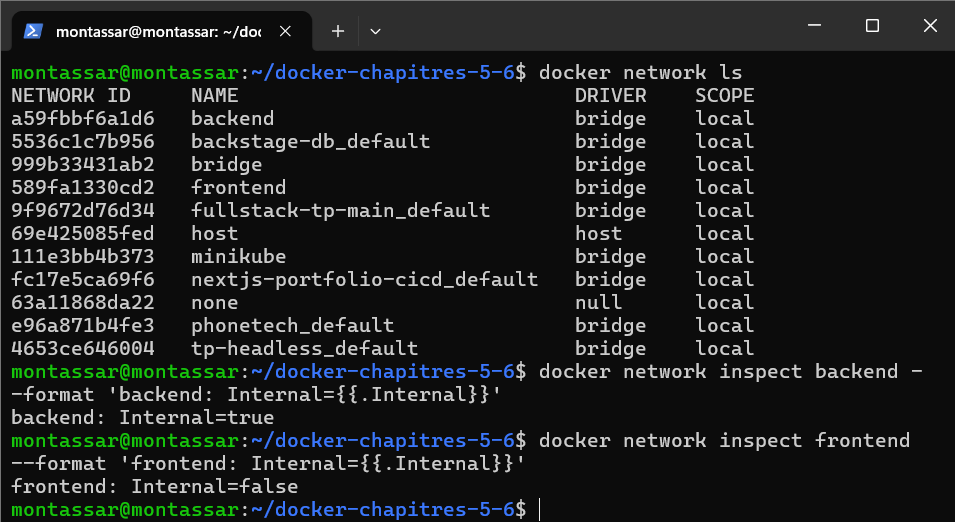
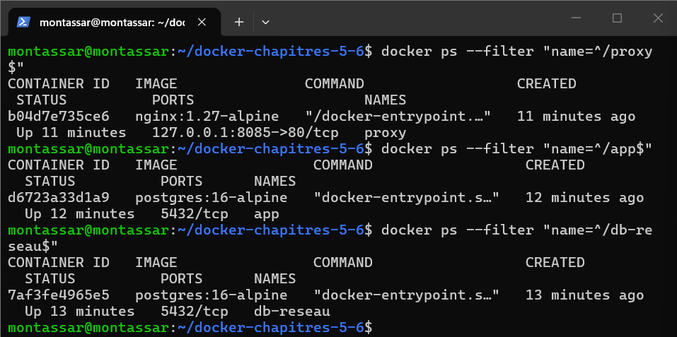
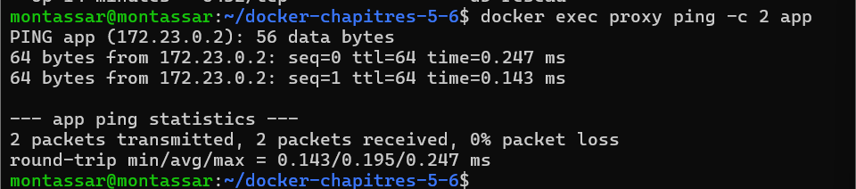
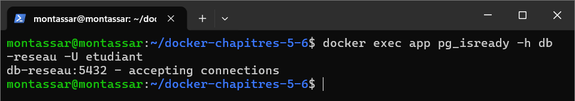
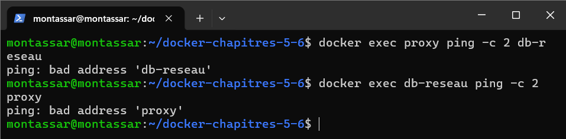
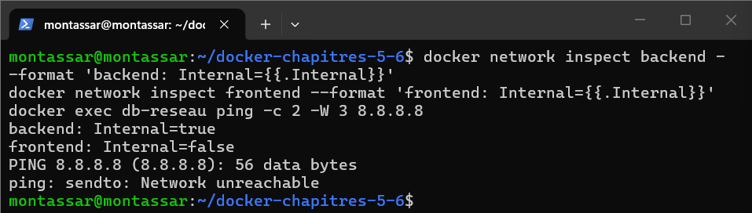

# Lab 6.2 — Isolation des réseaux Docker

## 1. Objectifs

- Créer deux réseaux Docker distincts.
- Connecter des conteneurs à plusieurs réseaux.
- Tester la communication entre conteneurs.
- Vérifier la résolution DNS Docker.
- Comprendre l'isolation réseau avec l'option `--internal`.

## 2. Environnement technique

- Système : Ubuntu
- Moteur : Docker
- Image PostgreSQL : `postgres:16-alpine`
- Image Nginx : `nginx:1.27-alpine`

## 3. Architecture

| Conteneur | Image | Réseaux |
|---|---|---|
| proxy | nginx:1.27-alpine | frontend |
| app | postgres:16-alpine | frontend, backend |
| db-reseau | postgres:16-alpine | backend |

Le conteneur `app` utilise la commande `sleep 3600` pour rester actif et tester les communications.

### Réseaux

| Réseau | Driver | Internal |
|---|---|---|
| frontend | bridge | false |
| backend | bridge | true |

Le proxy expose le port `80` sur `127.0.0.1:8085`. Les ports de `app` et `db-reseau` ne sont pas publiés sur l'hôte.

## 4. Création des réseaux

```bash
docker network create frontend
docker network create --internal backend
```

## 5. Création de la base de données

```bash
docker run -d \
  --name db-reseau \
  --network backend \
  -e POSTGRES_USER=etudiant \
  -e POSTGRES_PASSWORD=motdepasse-tp \
  -e POSTGRES_DB=cours \
  -v pgdata-reseau:/var/lib/postgresql/data \
  postgres:16-alpine
```

PostgreSQL a démarré correctement et a indiqué qu'il était prêt à accepter les connexions.

## 6. Création de l'application

```bash
docker run -d \
  --name app \
  --network backend \
  postgres:16-alpine \
  sleep 3600

docker network connect frontend app
```

Test :

```bash
docker exec app pg_isready -h db-reseau -U etudiant
```

Résultat :

```text
db-reseau:5432 - accepting connections
```

## 7. Création du proxy

Le port 8080 étant déjà occupé sur l'hôte, le port 8085 a été utilisé.

```bash
docker run -d \
  --name proxy \
  --network frontend \
  -p 127.0.0.1:8085:80 \
  nginx:1.27-alpine
```

Test HTTP :

```bash
curl http://localhost:8085
```

Résultat : la page d'accueil par défaut de Nginx s'affiche.

## 8. Tests de communication

| Test | Résultat | Observation |
|---|---|---|
| proxy → app | Réussi | 2 paquets reçus |
| proxy → db-reseau | Échec DNS | Nom non résolu |
| app → proxy | Réussi | 2 paquets reçus |
| app → db-reseau | Réussi | PostgreSQL accepte les connexions sur le port 5432 |
| db-reseau → proxy | Échec DNS | Nom non résolu |
| db-reseau → Internet | Échec | Network unreachable |

## 9. Vérification de l'isolation réseau

Les propriétés des réseaux ont été vérifiées avec Docker :

```bash
docker network inspect backend --format 'backend: Internal={{.Internal}}'
docker network inspect frontend --format 'frontend: Internal={{.Internal}}'


```

Résultats :

- backend : Internal=true
- frontend : Internal=false

Le conteneur db-reseau ne peut pas joindre 8.8.8.8 :

    ping: sendto: Network unreachable

## 10. Captures d'écran

### 10.1. Réseaux Docker



### 10.2. État des conteneurs



### 10.3. Communication proxy vers app



### 10.4. Connexion PostgreSQL



### 10.5. Isolation DNS



### 10.6. Réseau interne



## 11. Conclusion

Ce laboratoire a permis de pratiquer les réseaux bridge personnalisés, la résolution DNS entre conteneurs, la connexion d'un conteneur à plusieurs réseaux et l'isolation avec l'option --internal.

Les tests ont montré que les conteneurs communiquent lorsqu'ils partagent un réseau, tandis que les conteneurs isolés ne peuvent pas communiquer directement avec les autres réseaux.
